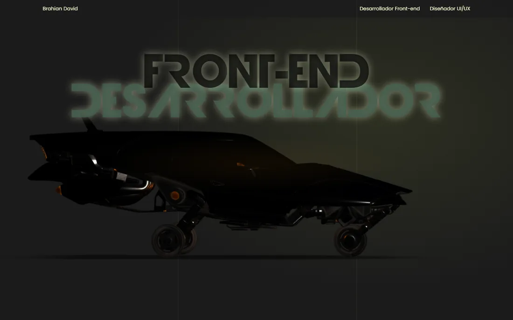

# 🚀 Portafolio — Brahian David

Portafolio personal con una **escena 3D en tiempo real**: un vehículo futurista que recorre las secciones del sitio, se acerca y se aleja de la pantalla según el contexto, mientras la tipografía reacciona de forma cinematográfica.

<p align="center">
  
</p>

---

## ✨ Qué incluye

- **Escena 3D interactiva** (Three.js): el modelo viaja por secciones con posición, escala y rotación propias; efecto de "impacto" final en Contacto.
- **Tipografía reactiva**: los títulos entran en cascada y se mueven con el scroll sin una sola línea de JS por frame (scroll-driven animations de CSS).
- **Sección de proyectos** con cards de los repos de [GitHub](https://github.com/Monkeyxcx) y un destacado **Sistegra SST** (trabajo actual, en producción).
- **Responsive** (escritorio/tablet/móvil) y **accesible**: `prefers-reduced-motion`, foco visible, semántica `section/h1/h2`, salto al contenido.
- Fuentes y assets **auto-alojados**, sin dependencias de terceros en el camino crítico.

---

## 🧠 Cómo funciona (lo simple)

| Archivo | Rol |
|---|---|
| `index.html` | Estructura semántica + **import map** con three.js fijado en `0.129.0` (la última versión cuyo loader soporta los materiales de `car.glb`). |
| `app.js` | Shell ligero: títulos, cards y observador de secciones. **three/gsap/modelo se cargan con `import()` dinámico tras `load` + `requestIdleCallback`**, fuera de la primera pintura. |
| `style.css` | Diseño, gradientes de fondo CSS puros, fuentes locales y animaciones (clase `.is-active` + `animation-timeline: view()`). |
| `car.glb` | Modelo **Draco** (996 KB) con animación y texturas WebP. |
| `draco/`, `fonts/`, `img/projects/` | Decodificador Draco local, fuentes subseteadas y capturas de proyectos en WebP. |

Flujo de la escena:

1. `IntersectionObserver` detecta la sección activa (cero listeners de scroll).
2. GSAP interpola posición/escala/rotación del modelo a esa sección.
3. Un **gobernador de render** ajusta fps (60 en interacción → 30 en reposo) y resolución (si un frame pasa de ~24 ms baja el pixel ratio y lo recupera cuando todo va fluido).
4. Las animaciones infinitas de las cards sólo corren cuando son visibles.

---

## ⚡ Mejoras de rendimiento aplicadas

Medidas con trazas de Chrome DevTools (antes → después):

| Métrica | Antes | Después |
|---|---|---|
| Tareas largas (>50 ms) | 163 | **50** (−68%) |
| First Contentful Paint | 347 ms | **95 ms** (−73%) |
| Recalculo de estilos por frame | 153 ms ×128 | **8 ms ×28** (−93%) |
| Decodificación de imágenes | 343 ms | **55 ms** (−84%) |
| JS cuadro a cuadro (FunctionCall) | 686 ms | **283 ms** (−64%) |
| Modelo 3D `car.glb` | 7,17 MB | **0,99 MB** (−86%) |
| Imagen de fondo | 18,4 MB (PNG) | **0** (gradientes CSS) |
| Fuentes | 7 peticiones bloqueantes a CDN | **locales, 394 → 136 KB** |
| Cards de proyectos | 1.007 KB externos (GitHub) | **140 KB locales** |

Otros cambios clave:

- Eliminadas lecturas de `getBoundingClientRect()` y escrituras de variables CSS **en cada frame**.
- Quitados `backdrop-filter`, `mix-blend-mode` y `filter: drop-shadow` de uso continuo.
- `content-visibility: auto` en las secciones fuera de pantalla.
- Modelo comprimido con **texturas 512 WebP + unión de mallas (126 → 93 draw calls) + Draco**.

---

## 🗂 Estructura

```
Portafolio/
├── index.html          # Página (5 secciones: inicio, sobre mí, habilidades, proyectos, contacto)
├── app.js              # Shell ligero + escena 3D diferida
├── style.css           # Diseño + tipografía reactiva + fondos CSS
├── car.glb             # Modelo 3D optimizado (Draco, 996 KB)
├── draco/              # Decodificador Draco local
├── fonts/              # Woff subseteados (locale)
├── img/
│   ├── bg.png          # Asset original (ya no se usa)
│   ├── projects/       # Capturas WebP de los repos
│   └── readme/         # Imágenes del README
└── .agents/            # Skills del agente (no versionadas)
```

---

## ▶️ Ejecutar en local

Es un sitio estático: cualquier servidor funciona.

```bash
# Python
python -m http.server 8123

# o con Node
npx serve .
```

Abre <http://127.0.0.1:8123/>.

> Importante: no abras `index.html` con `file://` — los módulos ES y la carga del modelo requieren HTTP.

---

## 🛠 Stack

**HTML · CSS · JavaScript (ES6+)** · [Three.js](https://threejs.org/) r129 · [GSAP](https://gsap.com/) 3.13 · GLTF + Draco · Scroll-driven CSS Animations
